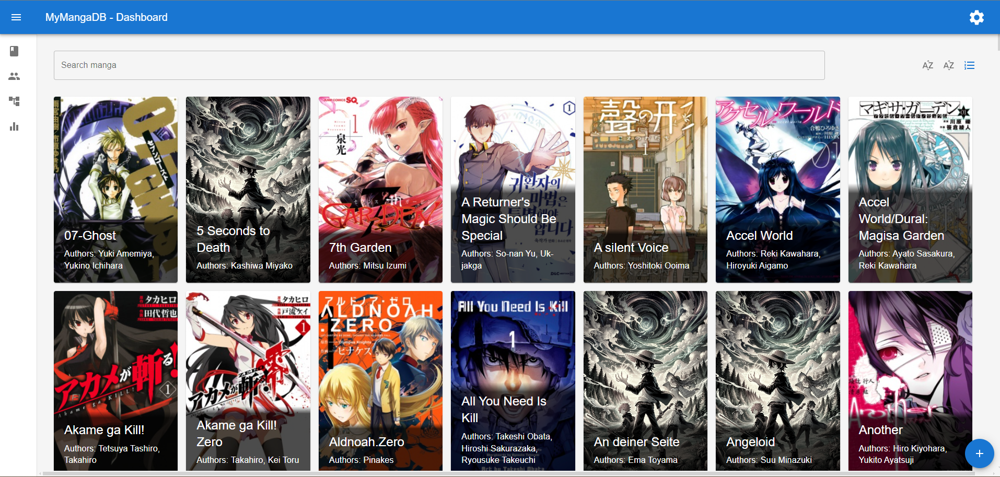
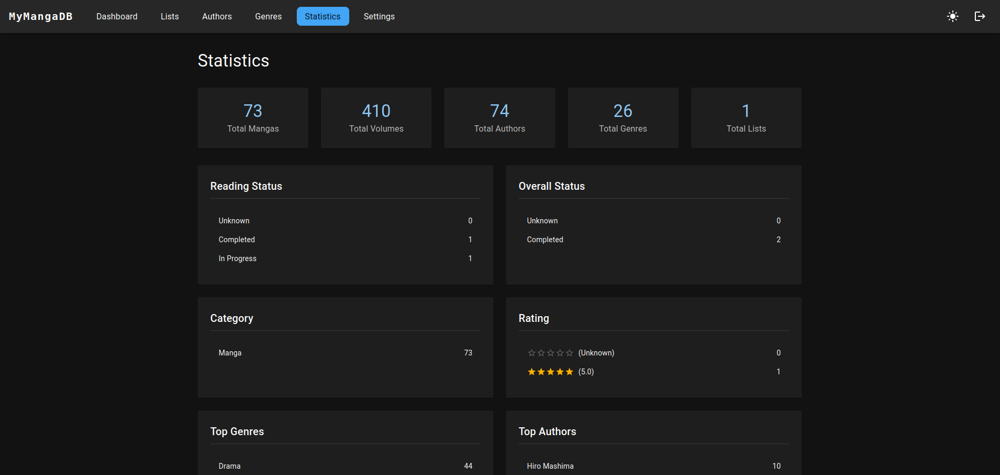

# MyMangaDB

**MyMangaDB** is the quintessential application for manga collectors. Say goodbye to spreadsheets and makeshift solutions. MyMangaDB offers a sleek, modern interface to manage your collection, automatically populating details like authors, genres, descriptions, and cover art.

## 🚀 Features

- **Automatic Metadata Fetching**: Simply enter a title, and MyMangaDB fetches all the details.
- **Collection Management**: Track what you own, what you've read, and what you plan to buy.
- **Statistics**: Visualize your collection with detailed charts and breakdowns of volumes, authors, genres, and more.
- **Import from MyAnimeList**: Easily migrate your existing collection by importing your MyAnimeList export file.
- **Role-Based Access Control (RBAC)**: Secure your database with Admin and Guest roles.
- **Responsive Design**: Manage your collection from your desktop or mobile device.
- **Docker Support**: Easy deployment with Docker and Traefik.
- **Multi-Language Support**: Available in English and German, with easy setup for additional languages.

## 🤝 Data Providers

MyMangaDB relies on excellent external APIs to provide accurate manga data. A special thanks to:

- **[Manga Passion](https://manga-passion.de/)**: For comprehensive data on German manga releases.
- **[Jikan API](https://jikan.moe/)**: For extensive data on anime and manga (English/Global).

## 📸 Gallery

### Dashboard



### Manga Overview


### Editing Manga


### Automatic Fetching


### Statistics



### Import from MyAnimeList


### Mobile View


## 🛠️ Installation & Deployment

### Docker (Recommended)

The easiest way to deploy MyMangaDB is using Docker. We provide a `docker-compose.yml` configured with Traefik for easy reverse proxying and SSL management.

1.  **Clone the Repository**

    ```bash
    git clone https://github.com/FabianRolfMatthiasNoll/MyMangaDB.git
    cd MyMangaDB
    ```

2.  **Configure Environment**

    Create a `.env` file next to `docker-compose.yml` and generate a secret
    signing key:

    ```bash
    echo "API_TOKEN=$(openssl rand -hex 32)" > .env
    ```

    `API_TOKEN` signs the authentication tokens (JWT). It is **required** for
    Docker deployments - the backend refuses to start without a valid key - so
    treat it as a server-side secret and never expose it to the frontend.

    Open `docker-compose.yml` and update the following:

    - **Traefik Labels**: Replace `<FrontendDomain>` and `<BackendDomain>` with your actual domains.
    - **Email**: Update `<MyEmail>` for Let's Encrypt SSL notifications.

3.  **Run the Application**

    ```bash
    docker-compose up -d
    ```

    Your application should now be accessible at your configured domains with HTTPS enabled.

### Configuration

| Variable       | Required    | Description                                  |
| -------------- | ----------- | -------------------------------------------- |
| `API_TOKEN`    | Docker: yes | Secret that signs the session tokens (JWT).  |
| `FRONTEND_URL` | no          | Origin allowed by CORS.                      |
| `DOCKER_MODE`  | image sets  | `true` in Docker; data lives in `/app/data`. |

When `API_TOKEN` is not set, the backend generates a random signing key on
first start and stores it next to the database
(`<database dir>/.secret_key`, `/app/data/.secret_key` in Docker). This keeps
local installations secure out of the box. Set `API_TOKEN` explicitly if you
run several instances or want the sessions to survive a reinstall.

### Local Home use

Just download the binaries from the latest release and use them. Available for linux and windows.

The binaries work without any configuration - if no `API_TOKEN` is set, a
random signing key is generated and stored next to the database, exactly like
the Docker fallback described above.

### Manual Installation (Development)

For contributors or those who prefer running without Docker.

**Prerequisites:**

- Python 3.12+
- Node.js 20+
- [Task](https://taskfile.dev/) (Taskfile runner)

1.  **Setup Environment**

    ```bash
    task setup
    ```

    This command creates virtual environments, installs dependencies, and generates `.env` files.

2.  **Run in Development Mode**
    ```bash
    task dev
    ```
    This starts both the FastAPI backend (port 8000) and Vite frontend (port 5173).

## 🔐 Authentication

MyMangaDB comes with pre-configured users. **Please change these passwords immediately after deployment.**

| Role      | Username | Password | Access                             |
| --------- | -------- | -------- | ---------------------------------- |
| **Admin** | `admin`  | `admin`  | Full access (Create, Edit, Delete) |
| **Guest** | `guest`  | `guest`  | Read-only access                   |

The backend logs a warning on every start while one of these accounts still
uses its default password.

Session tokens are signed with the `API_TOKEN` secret (see
[Configuration](#configuration)). There is no built-in default key: the
backend refuses to start when the configured key is a publicly known value,
so nobody can forge an admin session without knowing the secret.

## 🤝 Contributing

Contributions are welcome! Please follow these steps:

1.  Fork the repository.
2.  Create a feature branch (`git checkout -b feature/AmazingFeature`).
3.  Commit your changes (`git commit -m 'Add some AmazingFeature'`).
4.  Push to the branch (`git push origin feature/AmazingFeature`).
5.  Open a Pull Request.

## 📄 License

Distributed under the MIT License. See `LICENSE` for more information.
