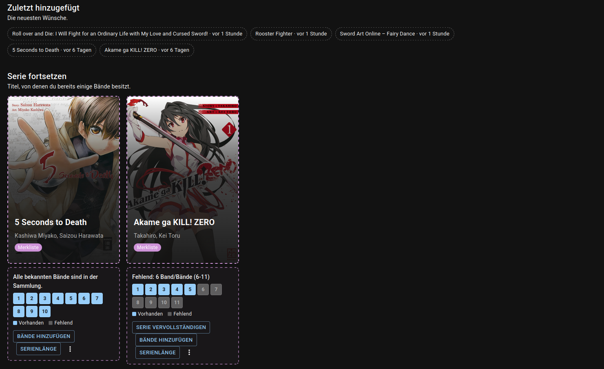
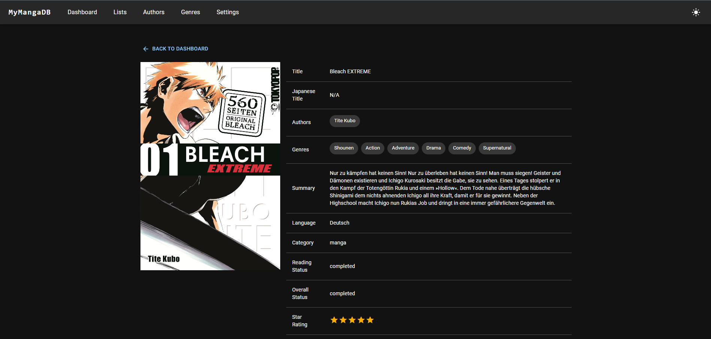
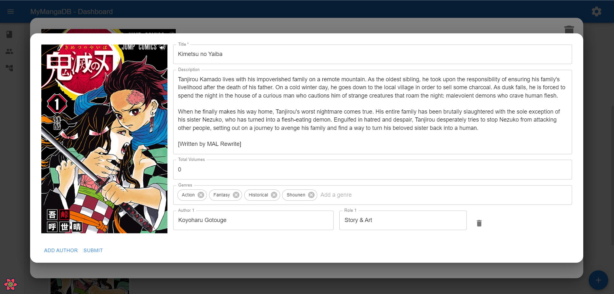
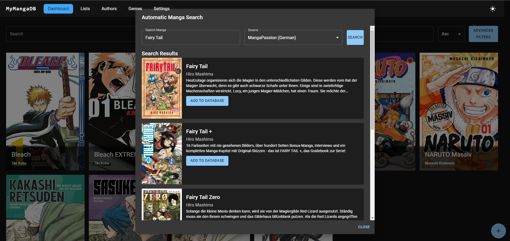
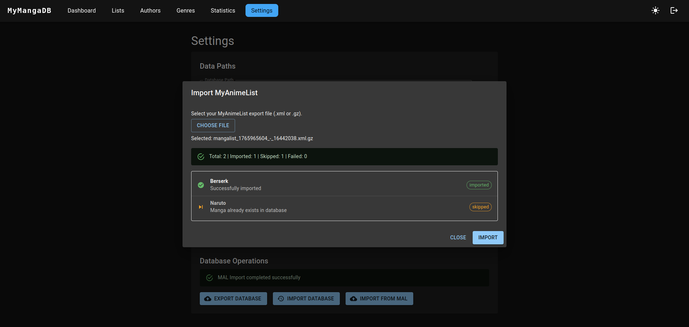
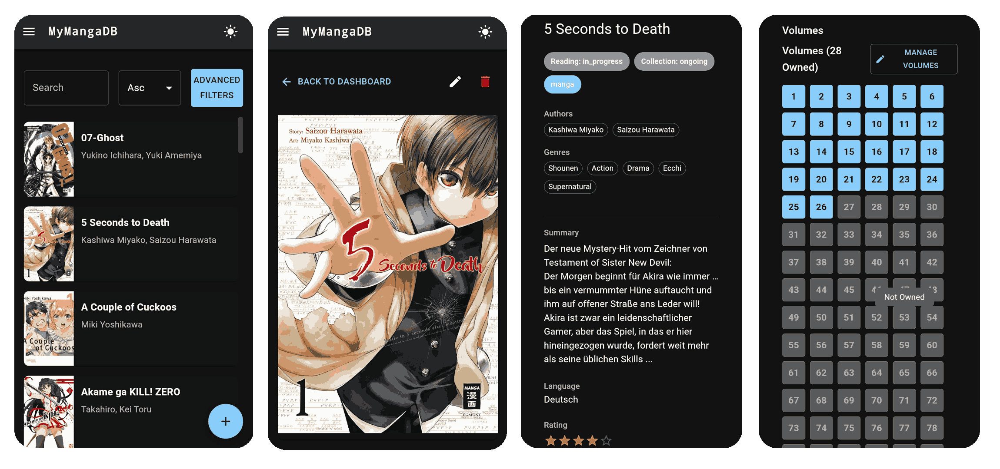

# MyMangaDB

**MyMangaDB** is the quintessential application for manga collectors. Say goodbye to spreadsheets and makeshift solutions. MyMangaDB offers a sleek, modern interface to manage your collection, automatically populating details like authors, genres, descriptions, and cover art.

## 🚀 Features

- **Automatic Metadata Fetching**: Simply enter a title, and MyMangaDB fetches all the details.
- **Collection Management**: Track what you own, what you've read, and what you plan to buy.
- **Wishlist**: Keep the titles you want apart from the ones you own, with a dedicated tab that shows which volumes of a series you are still missing.
- **Statistics**: Visualize your collection with detailed charts and breakdowns of volumes, authors, genres, and more.
- **Import from MyAnimeList**: Easily migrate your existing collection by importing your MyAnimeList export file.
- **Role-Based Access Control (RBAC)**: Secure your database with Admin and Guest roles.
- **Responsive Design**: Manage your collection from your desktop or mobile device.
- **Docker Support**: Easy deployment with Docker and Traefik.
- **Multi-Language Support**: Available in English and German, with easy setup for additional languages.

## 🤝 Data Providers

MyMangaDB relies on excellent external APIs to provide accurate manga data. A special thanks to:

- **[Manga Passion](https://manga-passion.de/)**: For comprehensive data on German manga releases.
- **[Jikan API](https://jikan.moe/)**: For extensive data on anime and manga (English/Global).

## 📸 Gallery

### Dashboard


### Wishlist




### Manga Overview



### Editing Manga



### Automatic Fetching



### Statistics


### Import from MyAnimeList



### Mobile View



## 🛒 How the wishlist works

The wishlist keeps the titles you want apart from the ones you own. It is
built around one rule: **the wanted volumes are the ones you are missing.**
A blue square in the strip is a volume on your shelf, a grey one is a
volume you still want.

1. **Say how long the series is.** "Series length" on a wishlist card - or
   "The series has volumes in total" on the page of a title - says how many
   volumes the series has in total. Everything up to that number that is not
   on your shelf is wanted.
2. **Put a title on the wishlist.** A title you already own can be marked as
   wanted on its own page; then the volumes it is missing are the ones you
   want. A title you do not own yet goes there from the automatic search.
3. **A volume arrives.** "Add volumes" puts it on your shelf. The rest of the
   series stays on the wishlist, and the title leaves the wishlist by itself
   when the last missing volume is there.

## 🛠️ Installation & Deployment

### Docker (Recommended)

The easiest way to deploy MyMangaDB is using Docker. We provide a `docker-compose.yml` configured with Traefik for easy reverse proxying and SSL management.

1.  **Clone the Repository**

    ```bash
    git clone https://github.com/FabianRolfMatthiasNoll/MyMangaDB.git
    cd MyMangaDB
    ```

2.  **Configure Environment**

    Create a `.env` file next to `docker-compose.yml` and generate a secret
    signing key:

    ```bash
    echo "API_TOKEN=$(openssl rand -hex 32)" > .env
    ```

    `API_TOKEN` signs the authentication tokens (JWT). It is **required** for
    Docker deployments - the backend refuses to start without a valid key - so
    treat it as a server-side secret and never expose it to the frontend.

    Open `docker-compose.yml` and update the following:

    - **Traefik Labels**: Replace `<FrontendDomain>` and `<BackendDomain>` with your actual domains.
    - **Email**: Update `<MyEmail>` for Let's Encrypt SSL notifications.

3.  **Run the Application**

    ```bash
    docker-compose up -d
    ```

    Your application should now be accessible at your configured domains with HTTPS enabled.

### Configuration

| Variable       | Required    | Description                                  |
| -------------- | ----------- | -------------------------------------------- |
| `API_TOKEN`    | Docker: yes | Secret that signs the session tokens (JWT).  |
| `FRONTEND_URL` | no          | Origin allowed by CORS.                      |
| `DOCKER_MODE`  | image sets  | `true` in Docker; data lives in `/app/data`. |

When `API_TOKEN` is not set, the backend generates a random signing key on
first start and stores it next to the database
(`<database dir>/.secret_key`, `/app/data/.secret_key` in Docker). This keeps
local installations secure out of the box. Set `API_TOKEN` explicitly if you
run several instances or want the sessions to survive a reinstall.

### Trying a development build

Every push to a branch publishes the container images to the GitHub Container
Registry under a **dev** tag, so a build can be tried on a server before it
is released. The images are **never** published as `latest` - that tag
belongs to the stable release.

| Tag            | Points at                                                      |
| -------------- | -------------------------------------------------------------- |
| `dev`          | The newest development build of `master`.                      |
| `dev-<sha>`    | One specific build. Use this to pin a server to a known state. |
| `dev-<branch>` | The newest build of a branch, e.g. `dev-feature-_87_wishlist`. |

To try one on a server:

```bash
echo "API_TOKEN=$(openssl rand -hex 32)" > .env
docker compose -f docker-compose.dev.yml up -d
```

The frontend is then on `http://<server>:8080` and the API on port `8000`.
Pin a specific build with `MYMANGADB_VERSION=dev-<sha>`.

The images are in the GitHub Container Registry. A public repository can be
pulled anonymously; a private one needs a token:

```bash
echo "$GITHUB_TOKEN" | docker login ghcr.io -u <user> --password-stdin
```

> The dev images are built from a branch, so they may contain work that is
> not released yet. The database is migrated automatically on startup - the
> same migrations a release would run.

### Local Home use

Just download the binaries from the latest release and use them. Available for linux and windows.

The binaries work without any configuration - if no `API_TOKEN` is set, a
random signing key is generated and stored next to the database, exactly like
the Docker fallback described above.

### Manual Installation (Development)

For contributors or those who prefer running without Docker.

**Prerequisites:**

- Python 3.13+
- Node.js 22.12+
- [Task](https://taskfile.dev/) (Taskfile runner)

1.  **Setup Environment**

    ```bash
    task setup
    ```

    This command creates virtual environments, installs dependencies, and generates `.env` files.

2.  **Run in Development Mode**

    ```bash
    task dev
    ```

    This starts both the FastAPI backend (port 1234) and Vite frontend (port 5173).

    Both ports can be changed, so that a second instance can run next to an
    already running one:

    ```bash
    BACKEND_PORT=8000 FRONTEND_PORT=5174 task dev
    ```

### Database Migrations

The database schema is managed with [Alembic](https://alembic.sqlalchemy.org/). The
migrations run automatically when the backend starts, so an existing installation
upgrades itself in place - no data is lost and the database never has to be reset.

To work on the schema directly:

```bash
cd backend

# Apply every pending migration
alembic upgrade head

# Create a migration for a model change
alembic revision --autogenerate -m "describe the change"
```

A database that was created before Alembic was introduced has no version table. It is
detected on startup, marked as the baseline and then upgraded with the migrations that
came after it.

## 🔐 Authentication

MyMangaDB comes with pre-configured users. **Please change these passwords immediately after deployment.**

| Role      | Username | Password | Access                             |
| --------- | -------- | -------- | ---------------------------------- |
| **Admin** | `admin`  | `admin`  | Full access (Create, Edit, Delete) |
| **Guest** | `guest`  | `guest`  | Read-only access                   |

The backend logs a warning on every start while one of these accounts still
uses its default password.

Session tokens are signed with the `API_TOKEN` secret (see
[Configuration](#configuration)). There is no built-in default key: the
backend refuses to start when the configured key is a publicly known value,
so nobody can forge an admin session without knowing the secret.

## 🤝 Contributing

Contributions are welcome! Please follow these steps:

1.  Fork the repository.
2.  Create a feature branch (`git checkout -b feature/AmazingFeature`).
3.  Commit your changes (`git commit -m 'Add some AmazingFeature'`).
4.  Push to the branch (`git push origin feature/AmazingFeature`).
5.  Open a Pull Request.

## 📄 License

Distributed under the MIT License. See `LICENSE` for more information.
